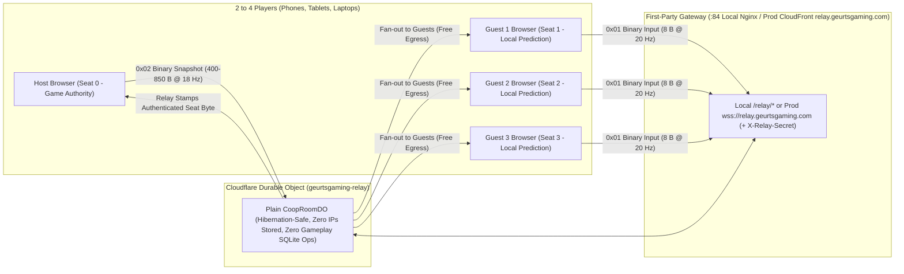
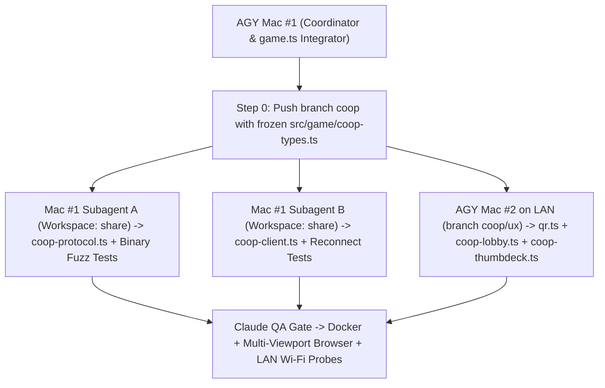

# Geurts Gaming — Low-Latency Co-op Architecture & Multi-Agent Implementation Plan

**Status:** Phase 0 Gate #0 Passed on Branch `coop` (`main` untouched at `ed462d9`)  
**Stack:** Plain Hibernation-Safe Cloudflare Durable Object (`relay/worker.mjs` + `relay/room.mjs` in `wrangler dev` Docker `:84`) + `partysocket` (`WebSocket` export) on Browser + CloudFront Subdomain Proxy (`wss://relay.geurtsgaming.com`)  
**Team Topology:** **AGY #1** (Sole Builder until Mac #2 arrives; keeps `src/game/coop-types.ts` as the single contract so **AGY Mac #2** can plug straight into UX/LAN testing when ready) · **Claude** (Independent QA, Security & Code Review) · **Dave** (Product Direction & Final Playtest)

> [!IMPORTANT]
> **Branch Safety Rule:** Every push to `main` deploys to live `geurtsgaming.com` within ~60 seconds. **Zero co-op feature commits go directly to `main`.** All co-op work happens on the `coop` feature branch (and sub-branches `coop/engine` & `coop/ux`) until Claude and Dave sign off on end-to-end QA.

---

## 1. System Architecture: Plain Durable Object Relay + `partysocket/ws` + Host-Authoritative Browser

1. **Plain Hibernation-Safe `CoopRoomDO` ([relay/worker.mjs](relay/worker.mjs) + [relay/room.mjs](relay/room.mjs))**:
   - Runs identically inside our `wrangler dev --local` Docker container ([relay/Dockerfile](relay/Dockerfile)) and on Cloudflare Workers — zero framework wrappers on the server.
   - Rehydrates room state from `ctx.storage` + `ws.deserializeAttachment()` ONLY during cold wake-ups (verifying monotonic socket generation counters `gen` so a late `close` from a dead Wi-Fi socket never undoes an already-completed reconnect).
   - Starts 30s grace timers on missing sockets after a Worker deploy/restart (`reconcileMissingSockets`), holds both lobby and in-game seats for 30s across phone screen-locks/refreshes, never arms a past `alarm()`, and performs **zero SQLite reads/writes during steady-state gameplay** (`0` storage ops).
   - **Zero Stored IP Addresses:** Stores zero IP addresses and zero raw browser IDs in `ctx.storage` (preserving `/privacy/`'s exact promise).
2. **`partysocket` `WebSocket` Client (`src/game/coop-client.ts`)**:
   - Uses the `WebSocket` export from `partysocket` (connecting to `/relay/room/<code>` locally or `wss://relay.geurtsgaming.com/room/<code>` in prod via a URL factory that injects the room-scoped `sessionStorage` seat token).
   - **Client safeguards:** Explicit `.close()` immediately upon receiving `refused` or `room-closed` (stopping infinite retries), bounded offline message queue (`maxEnqueuedMessages: 8`), `socket.readyState === WebSocket.OPEN` check before sending 20 Hz binary frames, and acting directly on `refused` / `room-closed` frames without waiting on `onclose`.

### Topology Diagram (Local LAN Docker & Production)



### Why Zero Server Physics Works Here
- **Single Source of Truth in [src/game/game.ts](src/game/game.ts):** Seat 0's browser steps waves, enemies ([src/game/enemies.ts](src/game/enemies.ts)), bosses ([src/game/boss.ts](src/game/boss.ts)), asteroids ([src/game/asteroids.ts](src/game/asteroids.ts)), fuel ships ([src/game/tanker.ts](src/game/tanker.ts)), and hitboxes. Enemies and bosses can **never** split-brain across screens.
- **0ms Local Feel on Guests:** Each guest steers their own ship locally at 60/120fps with instant muzzle tracers + sound effects while sending 8-byte target coordinates to the Host. Guests `lerp` enemy/boss/teammate coordinates between the two newest 18 Hz snapshots (`~55ms` render buffer) for silky-smooth motion.
- **Cost & Firewall Resilience:** Production uses a dedicated CloudFront distribution at **`wss://relay.geurtsgaming.com`** (one Route 53 record, leaving `geurtsgaming.com` on GitHub Pages untouched!) with `X-Relay-Secret` origin lock and CloudFront/Worker access logs disabled, at **$0.00/mo idle** and ~**$0.008 per 4-player game-hour** above Cloudflare's free tier.
- **Deterministic Seeded Set Pieces ([src/game/asteroids.ts](src/game/asteroids.ts)):** Instead of sending a 64–118 KB JSON rock field, the Host sends `{ type: "event", kind: "asteroid-field", wave, seed }` (~40 B); `createField` uses a seeded PRNG so every guest draws the identical asteroid field while the Host stays hit-authoritative.
- **Code-and-Number-Only Events:** `sanitizeHostEvent` in [relay/room.mjs](relay/room.mjs) strips all strings from `event` payloads, and the client ignores unknown `kind` values and never renders `kind` or key names as text.

---

## 2. Wire Protocol & Shared Playfield Specification ([src/game/coop-types.ts](src/game/coop-types.ts))

### Shared `3:4` Logical Playfield (`768 × 1024`)
- In Co-op mode, all devices simulate inside a fixed **`768 × 1024` (`3:4`)** logical coordinate space rendered via `ctx.setTransform(...)`:
  - **Laptops / Tablets / TVs:** Centered `3:4` arena with squad callsign/shield HUD strips.
  - **Portrait Phones (`390 × 844`):** Top 62% renders the full `768 × 1024` shared sky; **bottom 38% (`~320 CSS px`)** holds the **Thumb Steering Deck + Math/Typing Question Card** so a player's thumb never covers low-flying mines or teammates.

### Compact Binary & JSON Frames

| Frame Type | Direction | Rate | Size | Payload Layout |
| :--- | :--- | :--- | :--- | :--- |
| **`0x01` `BIN_INPUT`** | Guest → Relay → Host | 20 Hz | **8 bytes** | `[u8: 0x01, u8: seat (stamped by relay!), u16: targetX, u16: targetY, u8: flags (fire/bomb/shielded), u8: seq]` |
| **`0x02` `BIN_SNAP`** | Host → Relay → Guests | 18 Hz | **350–850 B** | Header (`tick, wave, teamScore, freedCount, setPieceState`) + `4 × 12 B` Pilot Ships + `N × 8 B` Enemies/Boss + `M × 6 B` Projectiles + `K × 6 B` Pickups + Compact Hit/Explosion FX (`Uint16` quantized `0..65535` on `768×1024`) |
| **`answer` (JSON)** | Guest → Relay → Host | On answer | **~75 B** | `{ type: "answer", seat, id, verdict: "perfect" \| "good" \| "failed", quality: 0..1 }` (Host ignores `id` if challenge isn't open; grade level never leaves device!) |
| **Control / Event (JSON)** | Bi-directional | Rare state transitions | **60–240 B** | `welcome`, `refused`, `lobby`, `ready`, `callsign`, `kick`, `leave`, `start`/`started`, `ping`/`pong` (60s keep-alive), `host-reconnecting`/`host-resumed`, `host-paused`, `room-closed`, `error`, numeric-only `event` |

### Host Rate Budget & Reconnect State Resync
1. **Rate Allowances & Drop Notice ([relay/room.mjs](relay/room.mjs)):**
   - Frequent visual effects (`hit`, `boom`, pickups) travel inside the 18 Hz `0x02` `BIN_SNAP` binary snapshot — never as per-hit JSON frames.
   - The Host receives a dedicated higher message budget (`HOST_MAX_MESSAGES_PER_SEC = 65`, flood close above `160/sec`), leaving 47 JSON messages/sec of headroom above the 18 Hz snapshot stream; Guests remain capped at `35/sec` (flood close above `90/sec`).
   - Whenever a message is dropped above `maxPerSec`, the relay sends `{ type: "error", reason: "rate-limited" }` once per 1-second window so dropped events are never silent in testing.
2. **Reconnect State Resync ([src/game/coop-types.ts](src/game/coop-types.ts)):**
   - Returning guests learn that a game has already started from `welcome.locked === true` (`started` is not re-sent).
   - Whenever the Host sees a guest seat transition from `connected: false` → `connected: true` in `lobby` while `locked === true`, the Host immediately sends targeted (`to: seat`) `event` frames for: (a) `'wave-sync'` (`wave`, `score`, `freed`), (b) `'asteroid-field'` (`wave`, `seed`) if an asteroid field is active, (c) `'tanker-start'` (`wave`) if a tanker is active, and (d) any open `'challenge'` or `'upgrade-offer'` for that seat.
3. **Explicit Leave vs Accidental Drop:** Clicking the Lobby **Leave** button sends `{ type: "leave" }` (freeing the seat immediately and invalidating its token), whereas tab refresh / phone screen-lock does *not* send `leave` so the 30-second seat hold applies.

### Privacy & Trust Invariants (`/privacy/` Alignment)
1. **Zero IP Recording:** Relay holds IP addresses strictly in transient Worker RAM for 60-second flood limits and never writes IPs to DO storage or logs.
2. **Per-Tab `sessionStorage` Only:** Room seat tokens (`gg_coop_token_<CODE>`) and per-tab `cid` live in `sessionStorage` only (never `localStorage`), documented in `src/data/trust.ts` when Co-op launches.
3. **Invite Link Stripped Before Analytics:** When `?j=ABCDEF` auto-join lands, an early inline `<head>` script in [src/layouts/Base.astro](src/layouts/Base.astro) stashes the code in `sessionStorage` (`gg_coop_invite`) and strips `?j=` via `history.replaceState` *before* the Google tag runs (since `gtag` ignores `page_location` overrides).

---

## 3. Role Matrix: AGY Mac #1 vs AGY Mac #2 (LAN) vs Claude vs Dave

> [!TIP]
> **Why This Split Works So Well:** Making **Claude** dedicated **QA, Security & Code Reviewer** eliminates multi-agent edits colliding in Mac #1's working tree, while **AGY Mac #2** has its **own separate physical Mac, Docker stack, and browser on your home LAN** — letting two Antigravity instances build orthogonal modules in parallel *and* test real cross-machine Wi-Fi multiplayer!

| Team Member | Machine | Role | Owns (Write Access) | Never Touches |
| :--- | :--- | :--- | :--- | :--- |
| **AGY #1** | **Mac #1** (Primary) | **Lead Architect, Engine/Netcode & Relay Builder** | `src/game/coop-types.ts`, `src/game/coop-protocol.ts`, `src/game/coop-client.ts`, `src/game/game.ts`, `src/game/asteroids.ts`, `src/game/tanker.ts`, `src/game/multiplayer.ts`, `relay/*`, `.github/workflows/*`, `tests/coop-protocol.test.ts`, `tests/relay.test.ts` | Lobby/QR CSS & components owned by Mac #2 while `coop/ux` is in flight |
| **AGY #2** | **Mac #2** (LAN Peer) | **UX/QR/Controller Builder & Cross-Mac LAN Stress Tester** | `src/game/qr.ts`, `src/game/coop-lobby.ts`, `src/game/coop-thumbdeck.ts`, `src/components/HeroGame.astro` (Co-op modal & HUD slots), `tests/qr.test.ts`, `tests/lan-coop-bot.mjs` | `relay/*`, `src/game/coop-protocol.ts`, core collision loops in `src/game/game.ts` |
| **Claude** | **Mac #1** (Reviewer) | **QA Lead, Security Auditor & Code Reviewer** | Adversarial probes, browser QA & code review reports in `feedbackforagy.md` | Feature implementation files during `coop` sprint (unless asked for a surgical fix) |
| **Dave** | **Human Lead** | **Product, Cloud Creds & Final Playtest** | Branch sign-offs, Cloudflare Worker token / CloudFront `relay.geurtsgaming.com` origin secret setup, real phone + laptop family playtest | Never has to run `npm` on host |

---

## 4. How AGY #1 Uses Subagents + How Mac #1 & Mac #2 Collaborate Over LAN



- **Local Subagents (`Workspace: "share"`):** Each subagent on Mac #1 gets its own isolated shared-repo worktree and strict single-file ownership (`src/game/game.ts` is touched only by AGY #1 Coordinator).
- **Live Cross-Mac LAN Arena (`http://<mac1-hostname>.local:84`):** On home Wi-Fi only (and brought back down immediately after testing!), a temporary `docker-compose.lan.yml` override on Mac #1 lets Mac #2 connect 3 real browser tabs over Wi-Fi (`?j=ABC-DEF`) to stress-test latency, jitter, QR joins, and revives across physical hardware.

---

## 5. Phased Implementation Plan (Small, Reviewable Commits on `coop`)

### Phase 0 — Cut `coop` Foundation (`main` untouched at `ed462d9`)
- **[Done — Claude]** Shipped `ed462d9` to `main` (in-memory grade picker, `/privacy/`, `/security/`, `/ai/`, analytics lock-down, Safari voice fix).
- **[AGY Mac #1]** Cut `coop` branch; Docker Node 24 stack, Mirage #1 Wi-Fi safeguard, Round 7 + Round 8 hardened Relay (`relay/room.mjs` + `relay/worker.mjs` + `tests/relay.test.ts`), and frozen `src/game/coop-types.ts` contract.
- **[Claude QA Gate #0]** Full Round 8 re-probe (`relay-probes*.mjs`, `relay-alarm-check.mjs`, `relay-probe-lateclose.mjs`, `relay-probe-alarmloop.mjs`, `relay-probe-restart.mjs`), `docker compose run --rm test`, and `docker compose run --rm build`.

### Phase 1 — QR Invite, 4-Seat Lobby & Auto-Reconnect
- **[AGY Mac #2 (`coop/ux`)]** Zero-dep SVG QR encoder (`src/game/qr.ts` + `tests/qr.test.ts`) + Co-op Lobby UI (`src/game/coop-lobby.ts` + `src/components/HeroGame.astro` hooks; say `"removed"` rather than `"blocked"` on kick).
- **[AGY Mac #1 (`coop/engine`)]** `src/game/coop-client.ts` (`partysocket` `WebSocket` wrapper, room-scoped `sessionStorage` token + `cid`, bounded queue, immediate `.close()` on `refused`/`room-closed`/`4001`, 55s `ping`/`pong`, `navigator.wakeLock` with release re-acquisition, `mp.setCoopActive(true)`, and early `<head>` `?j=` Analytics strip in `src/layouts/Base.astro`).
- **[Claude QA Gate #1]** 4 real browser windows joining via QR URL & typed code, host kick, mid-lobby refresh + 20s idle hibernation survival, late-close Wi-Fi reconnect, locking on Launch.

### Phase 2 — Shared `3:4` Arena, Binary Netcode & Smooth 4-Ship Flight
- **[AGY Mac #1 + Subagents (`coop/engine`)]** `src/game/coop-protocol.ts` (`0x01` input + `0x02` snapshot packer + `lerp` buffer), seeded PRNG in `src/game/asteroids.ts`, `3:4` (`768 × 1024`) arena + multi-ship simulation in `src/game/game.ts`, and 0ms guest local ship prediction.
- **[AGY Mac #2 (`coop/ux`)]** Portrait-phone bottom 38% Thumb Steering Deck (`src/game/coop-thumbdeck.ts`) + live cross-Mac LAN bot (`tests/lan-coop-bot.mjs`).
- **[Claude QA Gate #2]** Bandwidth (<1 KB/snap), 60fps smoothness under 60ms / 2% jitter, portrait phone ergonomics, zero solo regression.

### Phase 3 — Co-op Gameplay: Individual Questions, Revives, Set Pieces & Host Pause
- **[AGY Mac #1 (`coop/engine`)]** Per-device grade questions with amber shield bubble, rescue-pod revives, multi-ship `src/game/tanker.ts` refuel beam, `document.hidden` → `HOST PAUSED`, and Squad Mission Summary screen.
- **[AGY Mac #2 (`coop/ux`)]** Bottom-deck question/upgrade cards, squad shield/revive HUD, and Squad Mission Summary overlay.
- **[Claude QA Gate #3]** Mixed-grade playtest, boss & set-piece sync, host pause/disconnect grace, and zero solo leaderboard writes.

### Phase 4 — CloudFront `wss://relay.geurtsgaming.com` Prod Wiring + `/privacy/` Update + TV Mode
- **[AGY Mac #1]** GitHub Actions `wrangler deploy`, CloudFront `wss://relay.geurtsgaming.com` (`X-Relay-Secret` + `CloudFront-Viewer-Address`, access logs off), CSP update in `src/layouts/Base.astro`, and Co-op/Cloudflare disclosure + `sessionStorage` items in `src/data/trust.ts` / `/privacy/`.
- **[AGY Mac #2]** Optional **TV Mode (`?tv=1`)** toggle (`seat -1` big-screen arena + 4 phone controllers).
- **[Claude + Dave Final Prod Sign-Off]** Merge `coop` → `main` and multi-device family playtest on `https://geurtsgaming.com`!

---

## 6. Quick Starter Prompt for AGY Mac #2 (Copy-Paste Ready)

Once `coop` is pushed to GitHub after Gate #0 passes, paste this into Antigravity on your second Mac:

```text
You are AGY Mac #2, collaborating over LAN with AGY Mac #1 and Claude (QA/Review) on Geurts Gaming's 2-4 player Co-op mode.
1. Read COOP_ARCHITECTURE_PLAN.md and src/game/coop-types.ts first. Never run npm/astro directly on the macOS host — use Docker Compose exclusively.
2. Checkout the `coop` branch and create your working branch `coop/ux`.
3. Your ownership boundary is `src/game/qr.ts`, `src/game/coop-lobby.ts`, `src/game/coop-thumbdeck.ts`, Co-op modal/HUD hooks in `src/components/HeroGame.astro`, `tests/qr.test.ts`, and `tests/lan-coop-bot.mjs` (coding against `src/game/coop-types.ts`). Do not edit `relay/*`, `src/game/coop-protocol.ts`, or core simulation loops in `src/game/game.ts`.
4. Start with Phase 1 (`src/game/qr.ts` + `tests/qr.test.ts` and `src/game/coop-lobby.ts`), verify via `docker compose run --rm test` and `docker compose run --rm build`, and push `coop/ux` for review!
```
